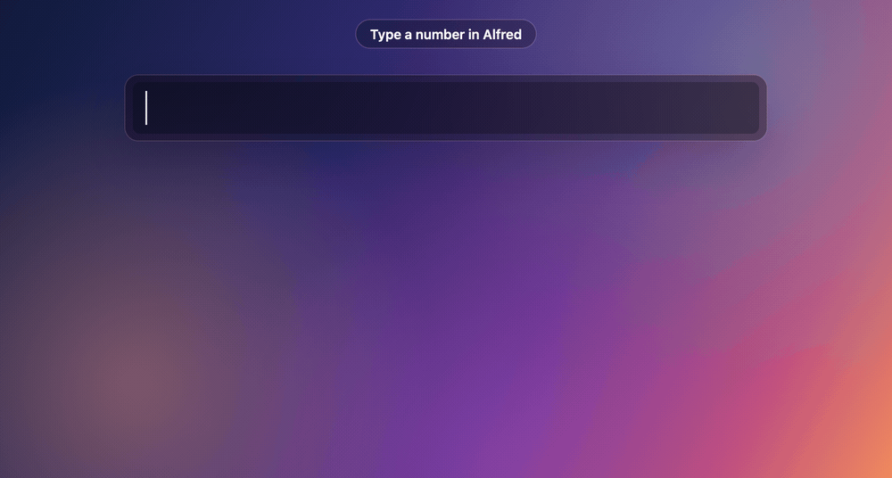

# Calculate Anything

An Alfred 5 workflow that converts things in natural language. Open Alfred and type a number: `100 usd to idr`, `100 km in miles`, `120 + 30%`, `2 gb to mb`. No keyword needed.

<p align="center">
  
</p>
<p align="center"><sub>The workflow's real answers, drawn in Alfred's Big Sur Dark theme. Rates as of 16 November 2026.</sub></p>

This is a rebuild of [Calculate Anything by Biati Digital](https://github.com/biati-digital/alfred-calculate-anything), which was archived in 2024 and stopped working: it needed PHP, which macOS no longer ships, and a fixer.io API key, which its free tier now rejects. This version keeps the features and the way you type, and needs neither.

- **No PHP.** It runs on the Python 3 that comes with Apple's developer tools (`/usr/bin/python3`), with no packages to install.
- **No API keys.** Exchange rates and crypto prices come from free public sources, with several fallbacks.
- **No waiting.** Rates download in the background. A query answers from the cached rates immediately and updates itself a moment later when newer ones arrive.

## Install

Download **Calculate.Anything.alfredworkflow** from the [latest release](https://github.com/situmorang-com/alfred-calculate-anything/releases/latest) and double-click it.

You need Alfred 5 with the Powerpack, and Apple's command line developer tools for `/usr/bin/python3` (if macOS offers to install them the first time, accept, or run `xcode-select --install`). If you still have the original Calculate Anything installed, disable it so results don't show twice.

To follow development instead, clone this repository into Alfred's workflows folder. To find that folder, right-click any workflow in Alfred Preferences, choose **Open in Finder**, and go up one level. Then:

```bash
git clone https://github.com/situmorang-com/alfred-calculate-anything.git user.workflow.calculate-anything
```

Alfred picks the workflow up at once. To update it later, run `git pull` in that folder.

## What you can type

### Currency

```
100 usd to idr            100 us dollars in mexican pesos
100 euros to dollars      100 euros a dolares        (your own language works)
100 usd mxn               100usd yen
100€ to $                 100 ¥ in €
100 eur                   converts to your base currencies
150k idr to usd           2.5 million yen to eur     (k, m, b, t or the words)
100 usd to idr eur myr    several targets at once
$100 to idr               €50                        ($ € £ ¥ first, no keyword)
1 gold to usd             10 g gold to idr           (gold and silver)
```

Around 170 currencies by code (`idr`), by symbol (`Rp`, `RM`, `€`, `£`, `¥`, `$`) or by name (`rupiah`, `ringgit`, `pounds`, `swiss francs`). With no target, the amount is converted to the base currencies from the configuration; left empty, that is this Mac's local currency plus USD, EUR and MYR.

### Cryptocurrency

```
1 btc                     2 bitcoins to dollars
5 bitcoins in ethereum    1eth btc
10 ethereum in mxn        1000 sats to usd
```

About 1,900 coins by ticker or name. A regular currency wins over a coin with the same ticker (PLN is the złoty). Because hundreds of tickers are everyday words, a bare `100 gas` only works for the 250 largest coins; spell out the target (`100 gas to usd`) for the rest.

### Units

```
100 kilometers to meters     100 km m          100oz = kg
-25F to C                    4500 ft2 to m2    100 ml to oz
10 years to months           1hr s             100 in to ft   (also shows 8 ft, 4 in)
100 kg                       72 f              180 cm         (no target: the other system)
5'11"                        5 ft 11 in to cm  1 1/2 cups to ml
100 mbps to mb/s             15 km/l to mpg    1 ghz to mhz
145 min to timespan          100 kn to lbf     9.81 m/s2 to g
```

Length, area, volume, weight, speed, angles, temperature, pressure, time, energy, power, frequency, force, acceleration, fuel economy, data rates and screen density. Use the abbreviation or the name, singular or plural. A unit typed alone converts to the other measurement system, or to your **Default units**.

### Data storage

```
100 gigabytes in megabytes    2 gb to mb    400MiB to kib    1b kb
4 gb at 50 mbps               how long the transfer takes
```

Follows the IEC standard: 1 MB = 1000 kB and 1 MiB = 1024 KiB. Turn on **Binary mode** in the configuration if you want 1 MB = 1024 kB.

### Percentages

```
120 + 30%          156 (and the 36 that was added)
120 - 30%          84
15% of 50          7.5
40 as a % of 50    40 is 80% of 50, plus the increase and decrease between the two
30 % 40            the same, short form
20% off 150        120
15% tip on 80      12 (and 92 with the tip)
```

### Number bases

```
255 to hex         255 to binary      255 to base 7      0xff
```

### px, em, rem, pt

```
12px       12px to em       2rem to pt       12px in em base 17px
```

### VAT

```
400 + vat          400 - ppn          vat of 400          vat 400 12%
```

`vat of 400` shows the tax, the amount with tax added, and the amount with tax taken out. The rate defaults to 11%, Indonesia's PPN on most goods and services. Change it in the configuration, or give a one-off rate in the query as in the last example (12% is the rate for luxury goods). `ppn` works wherever `vat` does without the keyword.

### Time (keyword `time`)

```
time now                              time 1577836800
time +15 days                         time now plus 3 days        time 3 days ago
time today + 3 workdays               time next friday 3pm
time days until 31 december           time hours since yesterday
time start of year                    time end of 2021            time end of next month
time 31 December, 2021 18:00:00       time 31/12/2021 18:00
time 25 December, 2021 - 31 December, 2021
time 3pm utc                          time now in tokyo
time monday in 3 weeks                time week 44 2026
time days left in this month          time workdays until 31 december
```

Each result is shown in every date format you configure, followed by how far away it is and its Unix timestamp. A zone after the time (`3pm utc`, `10:00 est`, `09:00 +09:00`) says where that time is, and the answer is in your zone. `in tokyo` shows the answer in that zone instead.

### Color (keyword `color`)

```
color #ff6600                  every format at once
color #ff6600 to hsl           color rgb(255, 102, 0) to hex
color tomato to cmyk           color hsl(24, 100%, 50%) to oklch
```

Reads hex, rgb(a), hsl(a), hwb, hsv, cmyk, lab, oklch and CSS color names.

### Bahasa Indonesia

```
500rb             1,5jt ke usd       2 juta rupiah       100 usd ke idr
5 ons             1 tumbak           2 hektar ke m2      15% dari 50
time besok        time 31 desember 2026                  time hari sampai 31 desember
```

Indonesian words work alongside English on a Mac set to Indonesia (the **Also understand** setting), and the results can be in Indonesian too (**Language**). `500rb` with no currency means rupiah.

## On a result

| Key | What it does |
| --- | --- |
| Return | copies the value as shown, for example `2,376.54` |
| ⌘ Return | copies the value without formatting, `2376.54` |
| ⌥ Return | copies the value of one unit (currency), or the value with its unit (units) |
| ⌃ Return | pastes the value into the app you were using |

Select an amount in any app (`$25`, `Rp 1.500.000`) and choose **Calculate Anything** from Alfred's Universal Actions to convert it, or type it after the `calc` keyword.

## Manual

Every query form, every setting, where the rates come from, adding your own words, and troubleshooting: [docs/MANUAL.md](docs/MANUAL.md).

## Changes

What changed from the original 4.0.7, and in each release since: [docs/CHANGELOG.md](docs/CHANGELOG.md).

## Working on the workflow

Start with [AGENTS.md](AGENTS.md): the rules, commands and change loop, for people and coding agents alike. Requirements, design and the project's memory are in [docs/](docs/).

## License

MIT, as the original. See [LICENSE](LICENSE). Flag icons and the workflow icon are from the original project.
